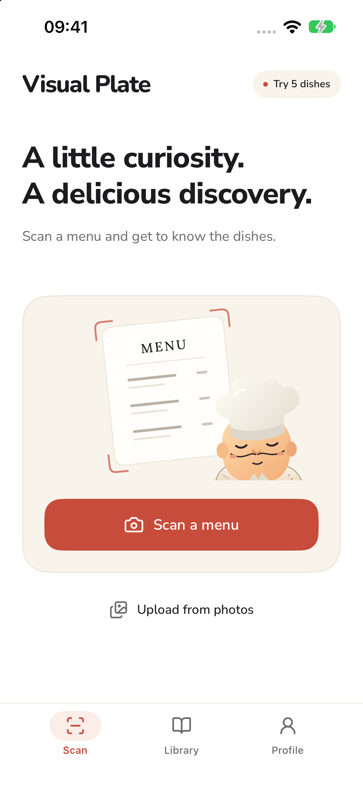

<p align="center">
  
</p>

<h1 align="center">Visual Plate</h1>

<p align="center">See what’s on the menu before you order.</p>
<p align="center"><a href="https://visual-plate.vercel.app">Visit the website</a></p>

Visual Plate is an iPhone app for exploring unfamiliar dishes. Take a menu photo or choose one from your gallery to discover dish images and descriptions, then revisit opened results and save favorites in your Library.

Eligible new accounts receive a **one-time allowance for 5 dish results**. The allowance counts opened dishes, not menu photos; it is not a recurring subscription trial. Standard includes **100 dish results for US$4.99/month**; Plus includes **300 for US$9.99/month**. Both plans include the same features, including all profile characters and app icons. Allowances renew each billing period without rollover. Local App Store prices may vary. Subscriptions and purchase restoration are handled inside the iPhone app.

<p align="center">
  
</p>

## What this repository contains

The public source for Visual Plate’s responsive marketing website, support page and notice-page placeholders. The iPhone app and backend are maintained separately. This static website does not perform menu recognition, handle accounts or payments, or send analytics events.

- Menu scanning and dish discovery overview
- One-time free allowance and subscription FAQ
- App artwork and a simulator capture of the Scan screen
- Support and legal notice routes

Dish information and images are for discovery. Confirm ingredients, allergens and dietary needs directly with the restaurant.

## Local development

Requires Node.js 22+ and Python 3. No npm dependencies or remote font requests.

```sh
npm run check
npm run build
npm run preview
```

Open http://127.0.0.1:4321 . Build output is written to `dist/`.

| Path | Contents |
| --- | --- |
| `src/content/landing.json` | English copy, FAQ and product content |
| `src/index.html`, `src/styles.css`, `src/site.js` | Responsive landing page |
| `public/brand/` | App icon, character artwork and bundled fonts |
| `public/screens/` | App screen capture |
| `src/review/` | Earlier SVG design compositions |
| `scripts/build.mjs` | Static site build and content validation |

Routes: `/`, `/support`, `/terms`, `/privacy`, `/analytics`, `/photo-improvement`.

## Publication status

The App Store link and App Store Connect configuration/purchase verification are pending. The approved US launch offer is reflected on the site. Legal routes display an explicit unpublished notice until final policies are approved. The build currently blocks search-engine indexing. App screenshots and illustrative scanning animation do not make AI requests from the website.

Brand assets come from Visual Plate’s app resources. Bundling these assets does not grant permission to reuse the Visual Plate name or artwork. Font license verification remains a release requirement.

## Support

For app, account, subscription or privacy questions, contact [hello@visualplate.app](mailto:hello@visualplate.app). Please do not send passwords, payment details or sensitive photos.

### Legal documents

Published policy sources are in `src/legal/`. Versioned HTML and pinned hashes preserve the documents linked to consent records. Local review drafts are excluded from production builds. Support: support@visualplate.app.
